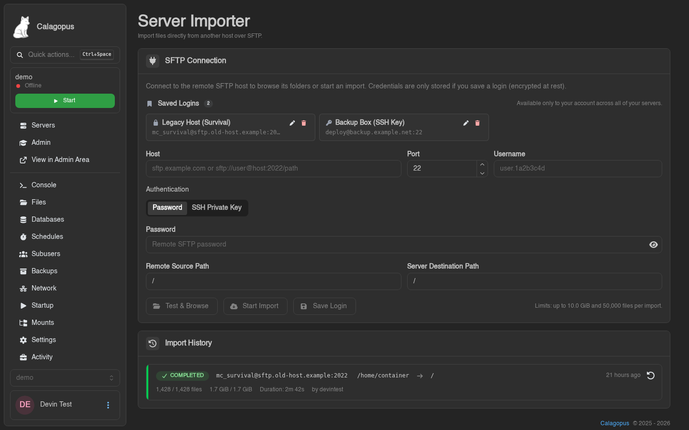
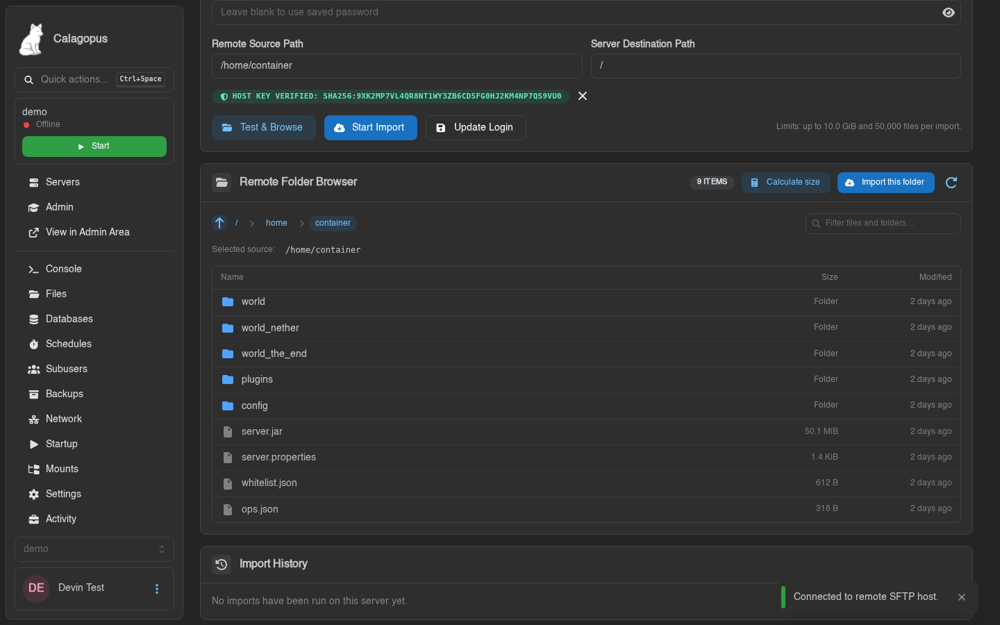
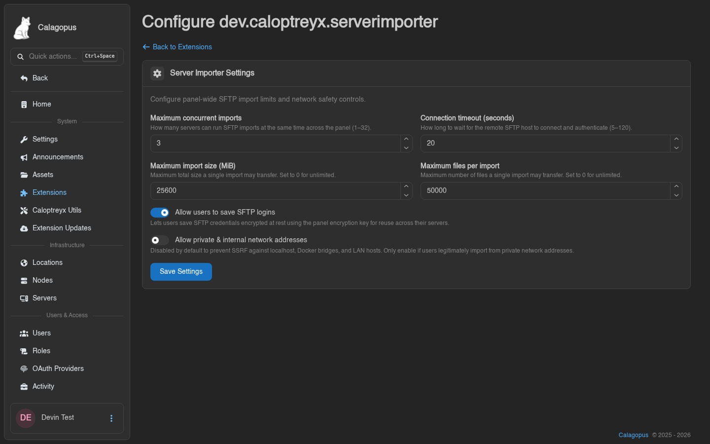

# Server Importer

A [Calagopus Panel](https://calagopus.com) extension that lets server owners import files from
another host directly into their server over **SFTP**, with remote folder browsing, encrypted saved
logins, size previews, SSH host-key verification, and live transfer progress.

Package name: `dev.caloptreyx.serverimporter` · Requires panel `>=1.2.10`

## Features

- **SFTP authentication:** connect with a password (with automatic keyboard-interactive fallback)
  or an OpenSSH private key (with optional passphrase). Credentials are never written to logs or
  import history, and are only persisted if you explicitly save a login.
- **Encrypted saved logins:** save frequently used SFTP logins (password or SSH private key +
  passphrase) for one-click reuse across all of your servers. Saved credentials are scoped to your
  user account, encrypted at rest using the panel's `APP_ENCRYPTION_KEY`, and never returned to the
  browser. Admins can toggle saved logins panel-wide in extension settings.
- **Test connection & remote folder browser:** browse and filter directories on the remote SFTP
  host, inspect its SHA256 SSH host-key fingerprint (automatically pinned for the import), and
  calculate folder file count and total size before starting.
- **Direct streaming to Wings:** streams files directly from SFTP to Wings over HTTP using
  pipelined SFTP reads without buffering imports on the panel's disk.
- **Live progress & cancellation:** shows phase (`connecting`, `scanning`, `transferring`), files
  and bytes transferred, transfer speed, ETA, current file, and per-file errors, with one-click
  cancellation and automatic cleanup of any partial file.
- **Import history:** records completed, failed, and cancelled imports per server (host, paths,
  counts, bytes, duration, and user) with one-click setting reuse and no stored credentials.
- **Safety & admin controls:** blocks loopback, link-local, and private network addresses by
  default (SSRF protection, overridable by admins), skips symlinks safely, respects subuser
  ignored-file rules, and enforces configurable concurrency, file count, and total size limits.

## Screenshots

**SFTP connection & saved logins**: connect via password or SSH private key, reuse encrypted saved logins, and review import history.



**Remote folder browser**: verify the SSH host-key fingerprint, browse remote directories, calculate folder size, and start an import.



**Admin settings**: configure concurrency, import size and file limits, saved-login availability, and private network protections.



## Permissions

- `server-importer.import` — browse a remote SFTP host, manage your own saved logins, and
  start/cancel imports on the server (starting an import also requires `files.create`).
- Admin settings require `extensions.read` to view and `extensions.manage` to update.

## Development & Packaging

Build a `.c7s.zip` archive for manual installation:

```bash
python3 scripts/package.py
```

Run frontend unit tests:

```bash
node --test "tests/*.test.ts"
```

## License

MIT — see [LICENSE](LICENSE).
